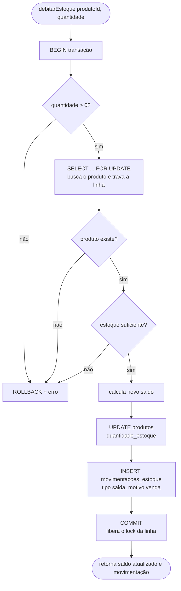
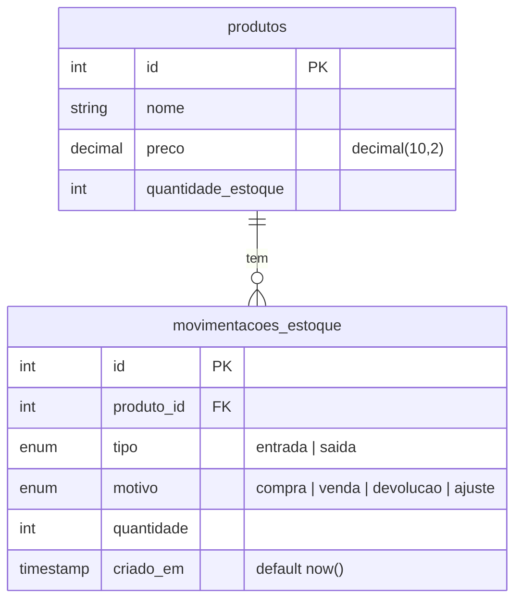

# stock-ledger-api


Projeto de portfólio que demonstra **controle de concorrência em banco de dados**: um estoque que nunca fica errado nem negativo, mesmo quando várias vendas debitam o mesmo produto ao mesmo tempo.

O foco não é a quantidade de funcionalidades, e sim resolver bem um problema clássico de sistemas reais: a *race condition* no débito de estoque. A solução é provada por um teste automatizado que dispara 50 débitos simultâneos no mesmo produto.

## Stack

- **Node.js** (JavaScript puro, ES Modules)
- **Express**
- **PostgreSQL 16**
- **Knex** (query builder e migrations)
- **Jest** (testes de integração contra um Postgres real, sem mocks)
- **Docker Compose** (app, Postgres e Adminer)
- **GitHub Actions** (CI rodando a suíte a cada push e pull request na `main`)

## Estrutura

```
src/
  db/
    connection.js        # instância única do Knex (pool de conexões)
    migrations/          # schema versionado: tabelas e trigger de append-only
  inventory/
    queries.js           # acesso ao banco, sem regra de negócio
    service.js           # regra de negócio: debitarEstoque
  server.js
test/
  connection.test.js     # teste de fumaça da conexão
  inventory.test.js      # queries, débito, validações, concorrência e append-only
```

## Como rodar

Pré-requisito: Docker com Docker Compose.

1. Crie o `.env` a partir do exemplo e preencha os valores:

   ```bash
   cp .env.example .env
   ```

   Os testes rodam dentro do container `app`, então o host do banco é o nome do serviço no Compose:

   ```
   POSTGRES_HOST=postgres
   POSTGRES_PORT=5432
   ```

2. Suba os serviços:

   ```bash
   docker compose up -d
   ```

3. Rode as migrations (cria as tabelas e o trigger):

   ```bash
   docker compose exec app npx knex migrate:latest
   ```

4. Rode os testes:

   ```bash
   docker compose exec app npm test
   ```

O Adminer fica disponível em `http://localhost:8080` para inspecionar o banco. A partir do host, o Postgres responde na porta `5433`.

> O script `npm test` usa a sintaxe `NODE_OPTIONS=... jest`, que funciona em shells Unix (dentro do container e no CI), mas não no `cmd`/PowerShell do Windows. Por isso o comando acima roda dentro do container.

## O problema: race condition no débito de estoque

Debitar estoque parece simples: ler o saldo, conferir se é suficiente, gravar o novo saldo. O problema aparece quando duas vendas do mesmo produto chegam ao mesmo tempo:

| Momento | Venda A | Venda B | Saldo no banco |
|---|---|---|---|
| 1 | lê saldo = 10 | | 10 |
| 2 | | lê saldo = 10 | 10 |
| 3 | grava 10 − 1 = 9 | | 9 |
| 4 | | grava 10 − 1 = 9 | **9** (deveria ser 8) |

As duas leram o mesmo saldo antigo, e a escrita da venda B apagou o débito da venda A. Esse padrão se chama *lost update*. Com saldo baixo, ele também permite vender mais do que existe: as duas vendas passam na checagem de "estoque suficiente" olhando o mesmo número.

A primeira versão de `debitarEstoque` (sem transação) tinha exatamente esse defeito, e o teste de concorrência falhava, comprovando o problema antes da correção.

## A solução: transação + `SELECT ... FOR UPDATE`

Em [`src/inventory/service.js`](src/inventory/service.js), `debitarEstoque` roda inteiro dentro de uma transação (`knex.transaction`), e a leitura do produto usa `SELECT ... FOR UPDATE` (`.forUpdate()` no Knex):

- **`FOR UPDATE`** trava a linha do produto até a transação terminar. Uma segunda venda do mesmo produto fica esperando na leitura, e só enxerga o saldo depois que a primeira gravou e fez commit. As leituras simultâneas viram uma fila, só para aquele produto.
- **A transação** garante que a atualização do saldo e o registro da movimentação acontecem juntos ou não acontecem: se qualquer passo falhar, o Knex faz rollback de tudo. Nunca fica um débito sem histórico, nem um histórico sem débito.



### Como isso é provado

O teste `50 débitos simultâneos no mesmo produto devem resultar no saldo correto` em [`test/inventory.test.js`](test/inventory.test.js) cria um produto com 100 unidades, dispara 50 chamadas de `debitarEstoque` ao mesmo tempo com `Promise.all` e confere que o saldo final é exatamente 50. Sem o lock, o saldo final vinha maior que o esperado, porque vendas se sobrescreviam.

A suíte também cobre os casos de rejeição: estoque insuficiente, produto inexistente e quantidade zero ou negativa.

## Histórico append-only

A tabela `movimentacoes_estoque` é o histórico do estoque e, por decisão de design, é **append-only**: uma movimentação nunca é editada nem apagada, só são criadas novas (uma correção entra como um novo lançamento, por exemplo de `ajuste`).

A regra não fica só no código da aplicação. Uma migration cria um **trigger** no Postgres (`impede_edicao_movimentacao`) que dispara `BEFORE UPDATE OR DELETE` e lança uma exceção. Assim o histórico fica protegido até de um `UPDATE` feito direto no banco. Há um teste que tenta alterar uma movimentação e espera o erro.

## Modelo de dados



- `preco` usa `decimal(10,2)` em vez de `float`, para não perder precisão com dinheiro.
- `tipo` e `motivo` são enums, então os valores válidos são garantidos pelo próprio banco.
- `criado_em` é preenchido pelo Postgres, não pelo relógio da aplicação.

## Status

A regra de débito de estoque, com concorrência, validações e histórico append-only, está implementada e testada. As rotas HTTP do domínio ainda não estão expostas no Express.
